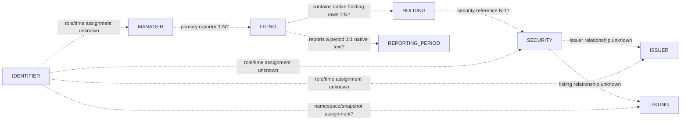

# Bounded candidate ERD — questions, not canonical tables

All keys/relations below are **PROPOSED or UNRESOLVED**, with no key selected for production and no canonical joins implemented. [Source witnesses and locators](../metadata/evaluations/agent_v2/inputs_v1.json) are partial observations; [candidate checks](../metadata/evaluations/agent_v2/proposals_v1.json) validate only their exact questions. Source-native token equality is not entity approval.

| Candidate entity | Candidate-key question (not an approved Business Key) | Supporting source evidence | Open ambiguity / alternative and consequence |
| --- | --- | --- | --- |
| MANAGER | Could source namespace + CIK + manager role + evidenced validity identify a source-native reporting party? | `submission103/104`: CIK `0001121477`, two accessions/periods; `cover100/104` distinguish Mirae USA/Hong Kong names and filing numbers. | Preserve source manager observations separately, or review a supported legal-entity link later. CIK role, temporal validity, primary versus other managers and legal entity versus parent/group remain unresolved. |
| FILING | Could exact source accession namespace + literal accession + source snapshot be the candidate native key? | `submission161` and `cover100`: `0001423255-13-000008`; `cover104` has `...000003`. | Keep immutable source filing occurrences; review cross-source accession linkage separately. Do not choose an amendment as authoritative or derive manager CIK from an accession prefix: `submission161` supplies a different CIK explicitly. |
| ISSUER | Could a scoped FSDS registrant CIK and validity support an issuer candidate, with role evidence? | `fsds_sub281`: `cik=9892`; 13F `holding170/316` supply `NAMEOFISSUER=APPLE COMPUTER` but no issuer CIK. | Keep issuer-name and registrant observations as source context, or require documented issuer links. A filing manager CIK is not automatically the holding issuer; names alone provide no canonical key. |
| SECURITY | Could scoped nonblank CUSIP/FIGI plus class/validity support a candidate identifier assignment? | `holding170/316` repeat `CUSIP=037833100`, `TITLEOFCLASS=COM`; FIGI is empty. | Keep candidate identifier observations or seek authoritative temporal security evidence. Same CUSIP does not deduplicate holdings; empty FIGI is not a key. Distinguish security, issuer and security class. |
| LISTING | Could full symbol + native namespace + exchange + snapshot/validity identify a source-native listing observation? | Supplementary GOLD `listing10/11`: ACT symbols `AAC.U` / `AAC.W`, exchange N, distinct unit/warrant descriptions and CQS/Nasdaq spellings. | Preserve distinct full symbols; review supported symbol/venue/security links later. No symbol-stem key, timeless symbol assignment, inferred unit decomposition or new C1500 admission. |
| IDENTIFIER | Could namespace + exact literal token + role/validity scope represent an identifier observation, retaining every provenance locator? | CIK `0001488106`, CIK `9892`, CUSIP `037833100`, SEC13F accessions and ACT symbols, with exact source/field contexts. | Keep source observations or review a typed identifier assignment. No padding/stripping, CIK↔CUSIP conversion, global uniqueness, canonical identifier registry or business-key approval. |
| HOLDING | Could source archive + native accession + INFOTABLE_SK be a candidate source key, with physical locator retained? | `holding170/316`: different accessions/SKs/values/locators with the same CUSIP; `holding40834` has `PUTCALL=Put`, `SSHPRNAMTTYPE=SH`. | Preserve every occurrence; validate any future key at its explicit scope before adoption. No deduplication by CUSIP/issuer/name, no blanket shares-versus-principal interpretation, no cross-filing position netting. |
| REPORTING_PERIOD | Could source role + exact period text + source grain/context (including FSDS qtrs) identify a period observation? | `submission161` / `cover100`: `30-JUN-2012`, filing date `04-JUN-2013`; `submission103/104` report 2011/2012 on the same filing date; FSDS ddate/qtrs and Treasury daily date are separate contexts. | Keep source-reported period observations; review any normalized-period equivalence separately. No historical alignment, calendar-duration inference, date-format coercion or filing-date substitution. |

| Proposed relation/cardinality question | Evidence-supported native observation | What remains unapproved |
| --- | --- | --- |
| MANAGER → FILING, 1:N for primary reporting role? | Two source SUBMISSION rows repeat CIK with distinct accessions/periods; additional-manager source tables exist in the retained 13F schema. | Canonical manager identity and primary/other-manager roles; possible M:N reporting-party relations beyond selected rows. |
| FILING → HOLDING, 1:N? | Existing INFOTABLE profile has repeated ACCESSION_NUMBER values, including 10,268 rows for one token; source occurrences remain distinct. | Enterprise key/cardinality outside this snapshot, amendment precedence and cross-file production joins. |
| FILING → REPORTING_PERIOD, one native reported-period text per selected SUBMISSION row? | `submission161`, `103`, `104` each contain one period field; several filings can share text. | Whether normalized periods are shared entities across sources/grains or need additional qualifiers. |
| HOLDING → SECURITY, N:1? | Multiple holding rows reference the same CUSIP token. | Whether the canonical security is the same over time and whether identifier assignment is unique; no canonical link established. |
| SECURITY → ISSUER and SECURITY ↔ LISTING | Source issuer labels and supplementary listing descriptions exist. | Cross-source identity links and cardinalities are not established by this set; keep **UNRESOLVED**, including possible composite instruments. |
| IDENTIFIER → candidate subjects | Namespaced tokens and source roles are observable. | Temporal assignment and cardinality; identifier-token equality cannot create canonical subject identity. |

Consequential review question: should any of these candidate keys/relations become semantic rules after independent evidence, or should observations remain source-native and separate? Retaining observations preserves uncertainty; adopting a key/link without that evidence risks false merges/splits and time/unit distortion. This experiment chooses no canonical key or relation. No Data Vault, canonical tables, new registry or production joins are created.
