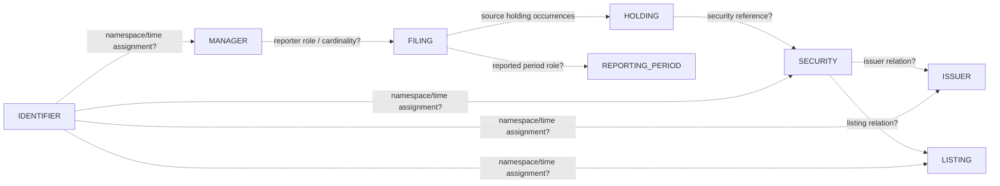

# Enterprise ERD candidate — Day 4

Every dotted edge is a **proposed or unresolved** relationship. No canonical table, production join, business key or cardinality is approved. Evidence and alternatives: [candidate ERD](../docs/agent_v2_candidate_erd.md) and [entity model](../docs/entity_model.md).

